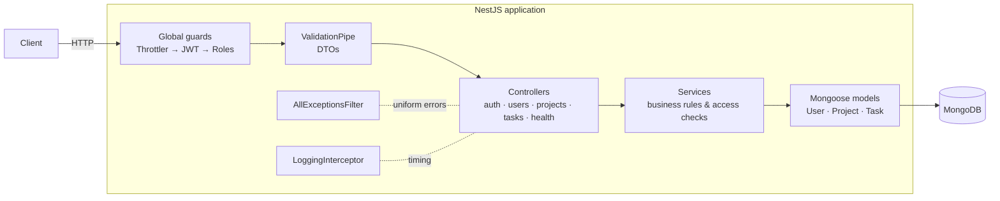

# nest-task-api

[](https://github.com/milohajko/nest-task-api/actions/workflows/ci.yml)


A production-shaped REST API for **projects and tasks**, built with **NestJS 11 + MongoDB**.
Small enough to read in one sitting, complete enough to show how I structure a real backend:
authentication with refresh-token rotation, role-based access, validation, consistent errors,
Swagger docs, unit + end-to-end tests, Docker and a CI pipeline.

> **Why this exists.** I have spent 8+ years on the MEAN stack and am currently migrating a large
> LoopBack 3 backend to NestJS at work. That code is private, so this repo is the public,
> reviewable version of how I build a NestJS service.

---

## Features

| Area | What is implemented |
| --- | --- |
| **Auth** | Register / login with bcrypt-hashed passwords. Short-lived **access JWT** + long-lived **refresh JWT** signed with different secrets. **Refresh-token rotation** with reuse detection (a replayed old token kills the session). Logout. |
| **Authorization** | Auth is **on by default** for every route (`@Public()` opts out). `@Roles(Role.Admin)` + `RolesGuard` for admin routes. Project-level access: owner vs member, enforced in the service layer. |
| **Domain** | `Projects` (owner + members by email) → `Tasks` (status, priority, assignee, due date). Nested REST routes. Cross-project `GET /tasks/mine`. |
| **Querying** | Filter (`status`, `priority`, `assignee`, `search`), sort (`sort=-dueDate`), paginate (`page`, `limit`) with a standard `{ items, meta }` envelope. Indexes match the query patterns. |
| **Validation** | `class-validator` DTOs, unknown properties rejected, ObjectIds validated with a pipe before hitting the DB. Environment variables validated with Joi at boot (fail fast). |
| **Errors** | One global filter → uniform JSON `{ statusCode, error, message, path, timestamp }`. Mongo duplicate key → `409`, Mongoose validation/cast → `400`. |
| **Ops** | `GET /health` (Terminus + Mongo ping), rate limiting (global + stricter on login), Helmet, CORS, graceful shutdown, request logging, URI versioning (`/api/v1`). |
| **Docs** | Swagger UI at `/docs`, generated from the DTOs and decorators. |
| **Tests** | Unit tests (services/guards with mocks) + e2e tests that boot the **real app** against an **in-memory MongoDB** — no Docker needed to run them. |
| **Delivery** | Multi-stage `Dockerfile` (non-root, healthcheck), `docker-compose.yml` with Mongo, GitHub Actions: lint → typecheck → build → unit → e2e on Node 20 & 22, then a Docker build. |

---

## Quick start

```bash
# 1. Install
npm install

# 2. Configure (defaults work with a local Mongo on 27017)
cp .env.example .env

# 3. Run (needs a MongoDB; see docker compose below for a one-liner)
npm run start:dev
# API      -> http://localhost:3000/api/v1
# Swagger  -> http://localhost:3000/docs
```

**No local Mongo?** Run everything in Docker:

```bash
docker compose up --build
```

**Just the tests** (no Mongo needed — an in-memory one is spun up automatically):

```bash
npm test          # unit
npm run test:e2e  # end-to-end
```

Try the API from `requests.http` (VS Code *REST Client* extension), or through Swagger at `/docs`
(click **Authorize** and paste the `accessToken` returned by `/auth/register`).

---

## API overview

All routes are prefixed with `/api/v1`. 🔓 = public, 👑 = admin only, everything else needs `Authorization: Bearer <accessToken>`.

| Method | Route | Description |
| --- | --- | --- |
| GET 🔓 | `/health` | Liveness + Mongo ping |
| POST 🔓 | `/auth/register` | Create account → `{ accessToken, refreshToken, user }` |
| POST 🔓 | `/auth/login` | Email + password → token pair (rate-limited 10/min) |
| POST 🔓 | `/auth/refresh` | `{ refreshToken }` → **new** token pair (old one invalidated) |
| POST | `/auth/logout` | Invalidate the refresh token |
| GET | `/users/me` | Current user profile |
| GET 👑 | `/users` | List users |
| POST / GET | `/projects` | Create / list my projects (owner or member) |
| GET / PATCH / DELETE | `/projects/:id` | Read (members) / update / delete (owner only) |
| POST | `/projects/:id/members` | Add member by email (owner only) |
| DELETE | `/projects/:id/members/:userId` | Remove member (owner only) |
| POST / GET | `/projects/:id/tasks` | Create / list+filter+sort+paginate tasks |
| GET / PATCH / DELETE | `/projects/:id/tasks/:taskId` | Single task |
| GET | `/tasks/mine` | Tasks assigned to me, across projects |

Example list call:

```
GET /api/v1/projects/66f.../tasks?status=todo&priority=high&search=readme&sort=-dueDate&page=1&limit=20
```

```json
{
  "items": [{ "id": "…", "title": "Write README", "status": "todo", "priority": "high", "...": "…" }],
  "meta": { "total": 1, "page": 1, "limit": 20, "pages": 1 }
}
```

---

## Architecture



### Request lifecycle

1. **ThrottlerGuard** – rate limit by IP (global 100/min, login 10/min).
2. **JwtAuthGuard** – verifies the Bearer access token with `passport-jwt`; skipped for `@Public()` routes. No database call here: the token carries `sub`, `email`, `role`.
3. **RolesGuard** – if the handler declares `@Roles(...)`, checks `request.user.role`.
4. **ValidationPipe** – transforms the JSON body / query into DTO instances and validates them; unknown fields are rejected (`forbidNonWhitelisted`).
5. **Controller** – thin: pulls the user with `@CurrentUser()`, delegates to a service.
6. **Service** – owns the business rules. Access checks live here (e.g. `ProjectsService.findOneForUser` returns **404** for both "missing" and "not yours", so project ids cannot be enumerated).
7. **AllExceptionsFilter** – turns any thrown error into the same JSON shape and maps DB errors to HTTP codes.

### Auth design

```
login/register ──► access JWT (15 min, secret A)
               └─► refresh JWT (7 days, secret B)  ──► bcrypt(refresh) stored on the user

refresh ──► verify signature with secret B
        ──► compare presented token with stored hash
              match     → issue a NEW pair, store the new hash  (rotation)
              mismatch  → wipe the stored hash → 403             (reuse / theft detected)
logout  ──► wipe the stored hash
```

Why: a stolen access token expires in minutes; a stolen refresh token becomes useless the moment
the legitimate client refreshes, and a replay of a rotated token logs *everyone* out.

### Project layout

```
src/
├── main.ts                 # bootstrap only
├── app.setup.ts            # HTTP config shared by main.ts and the e2e tests (prefix, pipes, Swagger)
├── app.module.ts           # wires modules + global guards/filter/interceptor
├── config/                 # typed env config + Joi validation
├── common/                 # cross-cutting: decorators, guards, filter, interceptor, pipe, pagination
├── auth/                   # register/login/refresh/logout, JWT strategies
├── users/                  # User schema + service (+ admin listing)
├── projects/               # Project schema, owner/member rules
├── tasks/                  # Task schema, filtering/sorting/pagination
└── health/                 # Terminus health check
test/
├── utils/test-app.ts       # boots AppModule against mongodb-memory-server
└── app.e2e-spec.ts         # full HTTP flows through supertest
```

---

## Testing strategy

- **Unit tests** (`src/**/*.spec.ts`) isolate one class and mock its collaborators — fast, and they
  pin down the *rules*: password check, refresh rotation + reuse detection, role checks, query → Mongo filter mapping.
- **E2E tests** (`test/*.e2e-spec.ts`) boot the real `AppModule` with the real guards, pipes and filter
  against an in-memory MongoDB and drive it over HTTP with `supertest`. They prove the *wiring*:
  401/403/404/409 behaviour, validation messages, pagination envelope, token rotation end to end.
- Both run in CI on Node 20 and 22. `npm run test:cov` prints coverage.

---

## Scripts

| Script | What it does |
| --- | --- |
| `npm run start:dev` | Watch mode |
| `npm run build` / `start:prod` | Compile to `dist/` and run it |
| `npm run lint` / `lint:fix` | ESLint (type-aware) + Prettier |
| `npm run typecheck` | `tsc --noEmit` |
| `npm test` / `test:cov` | Unit tests (+ coverage) |
| `npm run test:e2e` | End-to-end tests |

## Environment variables

See [`.env.example`](.env.example). All of them are validated at startup; the app refuses to boot with a missing or too-short JWT secret.

## Roadmap / ideas

- [ ] Angular dashboard consuming this API (separate repo)
- [ ] WebSocket gateway for live task updates
- [ ] Refresh token in an `httpOnly` cookie as an alternative to the JSON body
- [ ] Deploy to Render / Fly.io from the CI pipeline

## License

MIT
